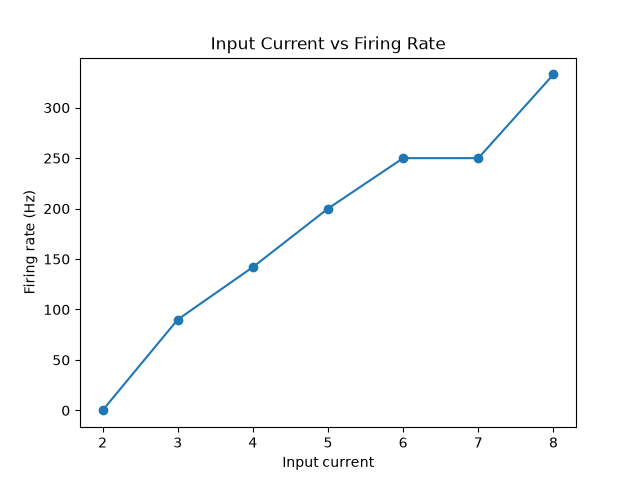

# Leaky Integrate-and-Fire Neuron Simulation

A small computational neuroscience project exploring how input current affects the firing behavior of a simplified leaky integrate-and-fire neuron.



## Research Question

How does input current affect the firing rate of a simplified leaky integrate-and-fire neuron?

## Hypothesis

I expect that increasing the input current will cause the neuron to reach its firing threshold more frequently, resulting in a higher firing rate.

## Model

This project uses a simplified leaky integrate-and-fire neuron model.

The neuron begins at a resting membrane voltage of **-70 mV**.

As input current is applied, the membrane voltage increases. At the same time, a leak term pulls the voltage back toward the resting potential.

The main parameters used in the simulation are:

- **Resting voltage:** -70 mV
- **Firing threshold:** -50 mV
- **Reset voltage:** -70 mV
- **Leak strength:** 0.1
- **Simulation length:** 1000 time steps
- **Time per step:** 1 ms

When the membrane voltage reaches or exceeds the firing threshold, a spike is counted and the voltage is reset to -70 mV.

The firing rate is calculated as the number of spikes produced per second and is expressed in hertz (Hz).

## Method

The neuron was simulated for several different input current values ranging from **2 to 8**.

For each input current:

1. The membrane voltage was reset to the resting potential.
2. The neuron was simulated for 1000 time steps.
3. The membrane voltage was updated using the input current and leak.
4. A spike was counted whenever the voltage reached the firing threshold.
5. The total number of spikes was converted into a firing rate in Hz.

The firing rate for each input current was then plotted to show how neuronal firing changes as input strength increases.

## Results

The simulation showed that increasing the input current generally increased the firing rate of the neuron.

At the lowest tested input current, the neuron did not produce any spikes.

As the input current increased, the neuron reached the firing threshold more frequently, causing the firing rate to rise.

The graph also shows a short plateau between some input values, where increasing the current did not immediately increase the firing rate. This is partly related to the simplified and discrete nature of the simulation.

Overall, the results support the original hypothesis that stronger input current leads to more frequent neuronal firing in this model.

## Limitations

This project uses a simplified model and does not reproduce the full biological mechanisms involved in real action potentials.

Real neurons depend on ion channels, membrane resistance, capacitance, refractory periods, synaptic inputs, and many other biological processes that are not included here.

The current implementation is intended as a beginner computational neuroscience experiment rather than a biologically complete neuron model.

## Future Work

Possible improvements include:

- Implementing a more realistic leaky integrate-and-fire equation
- Adding a refractory period after each spike
- Introducing random noise into the input current
- Recording and analyzing spike timing
- Measuring inter-spike intervals
- Comparing different neuron parameters
- Simulating multiple connected neurons

## Technologies Used

- Python
- Matplotlib

## Running the Project

Install the required package:

```bash
pip install -r requirements.txt
```

Run the simulation:

```bash
python main.py
```

The generated graph will be saved inside the `results` folder.